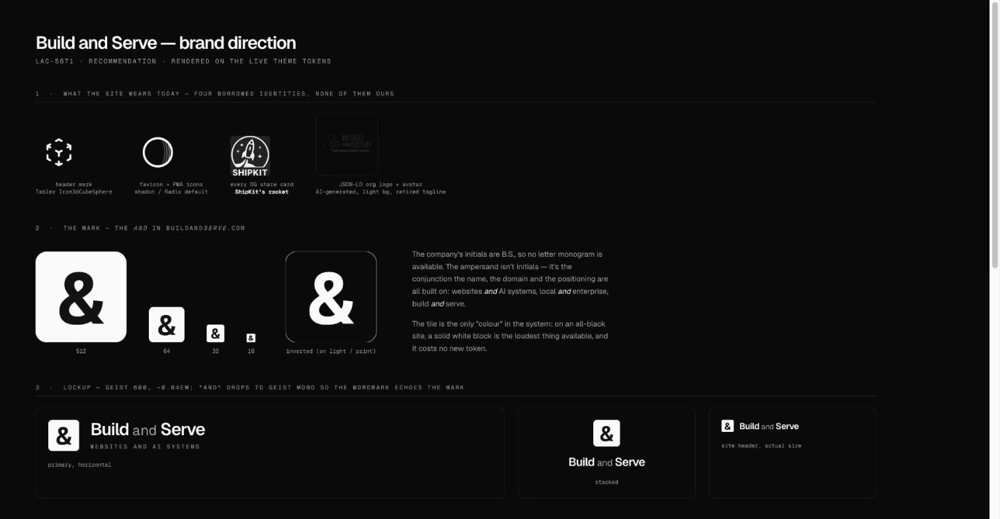
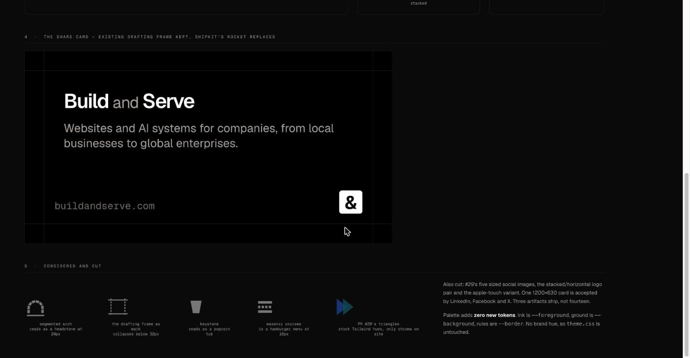
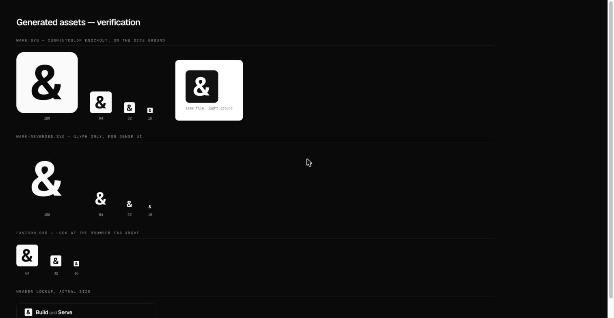

# Build and Serve brand direction

Design decision for [LAC-5671](/LAC/issues/LAC-5671), the direction half of closed PR
[#29](https://github.com/lacymorrow/buildandserve/pull/29). Approved assets live in `assets/`.
This document is the spec an implementation task builds against. It does not wire anything into
the app; nothing here is referenced by `src/` yet.

## The decision

Option 3 from the issue: a real direction, with #29's scope cut from fourteen artifacts to four.

## What the site wears today

The issue assumed the site is type-only and reads fine. It is not type-only. It wears four
identities and owns none of them.

| Surface | Today | What it is |
| --- | --- | --- |
| Header mark | `Icon3dCubeSphere` (`src/components/assets/kit-icon.tsx`) | A stock Tabler icon |
| `public/images/favicon.svg`, `public/app/web-app-manifest-{192,512}.png` | Striped crescent | The shadcn / Radix template default |
| `public/app/og-logo.png`, drawn on every card by `src/app/(app)/og/route.tsx` | Rocket | **ShipKit's logo** |
| `public/app/og-image.png` | Terminal screenshot reading `SHIPKIT` | Leftover from the template |
| `public/logo.png`, used as the JSON-LD organisation logo and the avatar | `</>` mark on a light background, tagline `WEB DEVELOPMENT AGENCY` | AI-generated, light-first on a dark-only site, and the tagline was retired by #47 |

The ShipKit rocket is a live defect on a client-facing site and is worth fixing whatever happens
to this direction. See "Fix first, independent of approval" below.

## The mark

The Geist Semibold ampersand, knocked out of a softened square tile.

The company's initials are B.S., so no letter monogram is available. The ampersand is not
initials. It is the conjunction that the name, the domain and the #47 positioning all run on:
websites *and* AI systems, local businesses *and* global enterprises, build *and* serve.

The tile is the only accent in the system. On an all-black site a solid white block is the
loudest thing available, and it costs no new token.

### Files

| File | Use |
| --- | --- |
| `assets/mark.svg` | Primary. Header, OG card corner, anywhere in-app. |
| `assets/mark-reversed.svg` | Glyph only, no tile, for dense UI where the block is too loud. |
| `assets/favicon.svg` | Tab and PWA icon at 24px and above. |
| `assets/favicon-small.svg` | 16px and below. Larger glyph, tighter corner. |

`make_mark.py` regenerates all four from the Geist outline; `extract.py` pulls that outline out
of the base64 OTF the OG route already ships in `src/app/(app)/og/`. No new font dependency.

### Two implementation constraints

**`currentColor` does not cross an `` boundary.** `mark.svg` is a single path filled with
`currentColor` and `fill-rule="evenodd"`, so the glyph is cut out of the tile and the page shows
through. That gives one file that inverts correctly on any ground, but only when the SVG is
inlined, as a React component or literal `<svg>` in markup. Loaded through ``
it is an isolated document, `currentColor` resolves to black, and you get a black tile on a black
page. Verified in Chrome. Inline it.

**The favicon cannot use `currentColor` at all.** A tab strip gives it no meaning and the mark
has to hold against both a light and a dark browser theme, so `favicon.svg` hard-codes `#fafafa`.

### Clear space and minimum size

Clear space on all four sides is the tile's corner radius, 12.5% of the tile. Minimum size is
16px, using `favicon-small.svg`. Do not recolour the tile, rotate the mark, outline it, or set
the glyph in any face other than Geist.

## Type

Geist Sans and Geist Mono, both already loaded by the site. No new typeface.

| Element | Spec |
| --- | --- |
| Wordmark | Geist 600, `letter-spacing: -0.04em`, sentence case: "Build and Serve" |
| The word "and" inside the wordmark | Geist Mono 400 at 0.8em, `--muted-foreground` |
| Descriptor under the wordmark | Geist Mono 400, uppercase, `letter-spacing: 0.22em`, `--muted-foreground` |

Dropping "and" to mono is what ties the wordmark to the mark: the same conjunction, called out
twice. It applies to the wordmark only, never to an arbitrary page title in an OG card.

The wordmark ships as live text, not as an SVG. It stays selectable, translatable and responsive,
and the site already loads the face. An outlined wordmark is only needed if print or a third-party
press kit ever asks for one.

## Palette

No brand hue. The palette adds **zero new tokens** and `src/styles/theme.css` is untouched.

| Role | Token |
| --- | --- |
| Ink | `--foreground` |
| Ground | `--background` |
| Rules and hairlines | `--border` |
| Secondary type | `--muted-foreground` |

The theme is achromatic on purpose and dark-only on purpose. The hero already runs nine
monochrome client logos. Adding a brand hue would put the only chroma on the site inside the
logo, which is what #29 did with Tailwind `blue-600` and `cyan-600`.

The accent is inversion, not colour. A white block on black is the emphasis mechanism.

## System

The drafting frame already shipping in `src/app/(app)/og/route.tsx` stays and becomes the brand's
container: dashed vertical rules and solid horizontal rules at a fixed 64px inset. It is
distinctive, achromatic, and already live. The only change to the card is that the rocket in the
bottom-right corner becomes the mark.

## Scope: four files, not fourteen

Cut from #29: the five sized social images, the stacked and horizontal logo pair, and the
apple-touch variant. One 1200x630 card is accepted by LinkedIn, Facebook and X, and the card is
generated per-page by the OG route rather than baked.

## Considered and cut

Each was drawn and rendered at 512, 64, 32 and 16px on the real theme tokens before being cut.

| Direction | Why it was cut |
| --- | --- |
| Segmented arch on a rule (build as a vault, serve as a cloche) | Reads as a headstone at header size. Confirmed at 24px. |
| The drafting frame promoted to the mark | Collapses into a selection marquee below 32px. |
| Keystone | Reads as a popcorn tub. |
| Masonry courses, solid over dashed | Is a hamburger menu at 16px. |
| Right-angle and geometric monoline ampersands | Legible as constructed, but neither beat the Geist glyph. |
| Striped ampersand, and a single rule through the glyph | Stripes break the glyph apart below 48px; a single rule reads as a strikethrough. |
| #29's two overlapping triangles | Stock Tailwind hues, the only chroma on an achromatic site, and the generic two-shapes move. |

## Known caveat

The glyph is Geist's ampersand, outlined, not drawn from scratch. The design work here is the
knockout tile, the optical centring, the small optical size and the system around it. A
custom-drawn ampersand is a reasonable follow-on once the direction is approved, and nothing in
this spec blocks it: the mark would change, the type, palette and system would not.

## Fix first, independent of approval

`public/app/og-logo.png` is ShipKit's rocket and it is drawn on every share card buildandserve.com
produces, so every link posted to LinkedIn or Slack today carries another product's logo.
`public/app/og-image.png` is a ShipKit terminal screenshot. Neither depends on this direction.

## Implementation notes

An implementation task against this spec touches:

- `src/components/assets/kit-icon.tsx`, which returns the Tabler icon the header renders
- `public/images/favicon.svg` and `public/app/web-app-manifest-{192,512}.png`
- `public/app/og-logo.png`, drawn at line 92 of `src/app/(app)/og/route.tsx`
- `public/app/og-image.png`
- `public/logo.png`, referenced by `src/components/primitives/json-ld.tsx` and
  `siteConfig.creator.avatar`

It changes the visible appearance of a live client site, so it needs a board gate at merge time.
That gate belongs on the implementation task, not on LAC-5671.

## Evidence

Rendered on the live theme tokens in Chrome.

